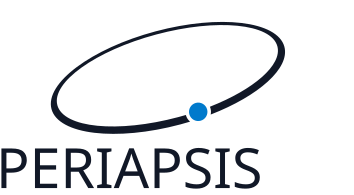

  <picture>
    <source media="(prefers-color-scheme: dark)" srcset="docs/images/periapsis-dark.svg">
    <source media="(prefers-color-scheme: light)" srcset="docs/images/periapsis-light.svg">
    
  </picture>
   
  <em>A companion to the C++ standard library.</em>

# Periapsis

A future-focused template library.

## Features

- **C++23 Modules** — Import the entire library with `import synodic.periapsis;`
- **Constexpr Everything** — Containers and algorithms designed for compile-time evaluation
- **Concept-Constrained** — Clear, enforceable type constraints throughout

## Setup

See [Setup](https://synodic.github.io/periapsis/setup) for setup instructions.

## Development

Python is required for development.

See [Development](https://synodic.github.io/periapsis/development) for build, test, and installation instructions.

## Documentation

- [Containers](https://synodic.github.io/periapsis/containers) — Fixed, sparse, and lock-free containers
- [Graph Library](https://synodic.github.io/periapsis/graph) — Graph data structures and traversal
- [Automata](https://synodic.github.io/periapsis/automata) — Finite state machines
- [Algorithms](https://synodic.github.io/periapsis/algorithms) — Graph algorithms
- [Math](https://synodic.github.io/periapsis/math) — Linear algebra types
- [Concepts](https://synodic.github.io/periapsis/concepts) — Type constraints
- [Traits](https://synodic.github.io/periapsis/traits) — Metaprogramming utilities
- [Strings](https://synodic.github.io/periapsis/strings) — String utilities
- [Threading](https://synodic.github.io/periapsis/threading) — Thread utilities

## License

This project is licensed under the MIT License — see [LICENSE.md](LICENSE.md) for details.

Copyright © 2025 Synodic Software
